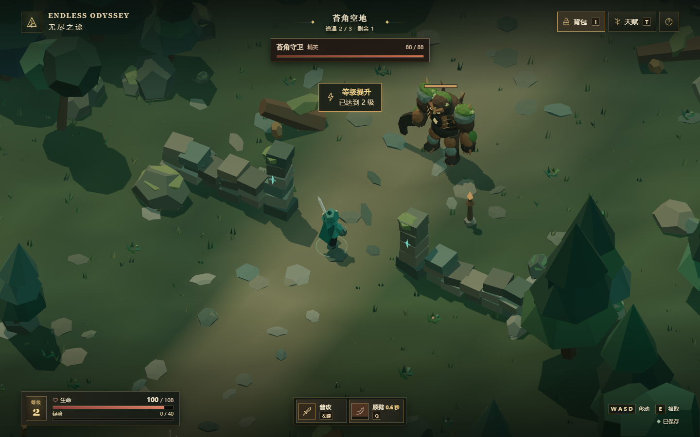

# Endless Odyssey

Endless Odyssey（无尽之途）是一款原创奇幻俯视角 3D 刷宝动作角色扮演游戏。玩家在浏览器中独自进入副本，击败怪物，比较战利品，再带着新装备挑战更强的敌人。核心玩法参考《暗黑破坏神》《火炬之光》和《流放之路》。

**当前可玩内容**：灰棘林地与守关 Boss、普攻和顺劈、升级与 20 节点天赋树、随机装备与六个穿戴槽、分解和浏览器本地存档。首个原创森林精英由资产流水线生成。无限深渊、图鉴和装备强化属于后续路线。各系统的运行与验收状态见[可视化进度表](docs/progress.html)。

## 本地运行

使用 Node.js 24，在仓库根目录执行：

```sh
npm ci
npm run dev
```

用桌面浏览器打开终端给出的地址，从营地选择「出发远征」。WASD 移动，鼠标指向目标，左键普攻，Q 顺劈，E 拾取，I 打开背包，T 打开天赋。浏览器刷新后从营地继续，已入账的角色成长与物品保存在当前站点的 IndexedDB。



| 工作 | 命令 |
| --- | --- |
| 领域与存档回归 | `npm test` |
| 掉率模拟 | `node tools/balance/simulate-loot.mjs --kills 100000 --level 1 --seed 25`，输出普通、精英与 Boss 各自的件数、品质和词条分布 |
| 浏览器回归 | `npm run test:e2e`，Windows 自动寻找 Chrome 或 Edge；其他环境可先执行 `npx playwright install chromium` |
| 静态部署包 | `npm run build`，将 `dist/` 的内容发布到静态主机；`npm run preview` 可本地检查产物 |
| 重新生成并验收苔角守卫 | `node tools/asset-pipeline/cli.mjs data/asset-specs/moss-warden.json --channel chrome` |

资产入库流程与建模坐标见[工具说明](tools/asset-pipeline/README.md)，技术取舍见[参考项目调研](docs/design/reference.md)。首版构建、浏览器实玩、掉率模拟与视觉证据见[验收记录](docs/acceptance.md)。

## 两个同等重要的产品

系统设计入口见[全游戏系统总览与开发顺序](docs/design/systems.md)。其中列出了天赋、技能、战斗、怪物、地图、深渊与工程工具的分册；装备的详细规则见[装备系统设计规格](equipment-system-design.md)。

| 产品 | 使用者 | 最小交付 |
| --- | --- | --- |
| 游戏本体 | 玩家 | 在一张地图中遭遇怪物，完成战斗与升级，拾取随机装备并穿戴，在下一场战斗中体验属性变化。 |
| AI 游戏资源生产流水线 | 内容作者、Codex 等 AI Agent | 从一份怪物规格生成模型与配置，渲染预览，自动验收，通过后注册资产并在游戏中刷出这只怪物。 |

两者通过**资产注册表与玩法配置**衔接。流水线可以独立运行，也可以为其他游戏生产内容。游戏发布时只需携带已验收的资产、配置和运行时代码。

## 游戏玩法

### 战斗与刷宝

**进入地图 → 遭遇怪物 → 击杀并获得经验和战利品 → 比较装备、调整构筑 → 挑战更高难度。**

首版用三种攻击方式可区分的怪物验证这条循环。怪物配置决定行为、技能和掉落表。装备模板决定部位、基础属性和可用词条，掉落时再生成具体数值。同一把剑可以共用模型，但因攻击速度、暴击概率或特殊触发效果不同，适合不同的角色。

**装备设计示例 · 雷霆之誓**

| 属性 | 示例数值 |
| --- | --- |
| 类型与需求 | 传说单手剑，需求等级 25 |
| 基础伤害与攻速 | 攻击伤害 128–186，每秒攻击 1.6 次 |
| 词条 | +24% 攻击速度、+18% 暴击概率、+36 雷元素伤害 |
| 传说效果 | 暴击时释放连锁闪电，最多攻击 5 个敌人。 |

### 天赋、技能与长期成长

升级提供天赋点。天赋树初期规划 20 个节点，搭配 4 种技能。界面需要展示可用点数、节点效果与消耗，支持加点和重置。例如，玩家可花 1 点解锁「雷暴」，使攻击有概率触发闪电，再通过装备强化攻速或暴击。后续可扩展召唤、吸血等流派。

| 系统 | 成长方式 |
| --- | --- |
| 角色与技能 | 击杀积累经验，升级获得天赋点，技能可提升等级并改变形态。 |
| 装备 | 随机掉落提供基础属性与词条，后续加入强化、词条重铸。 |
| 地图与怪物 | 随机副本组合地形与遭遇，难度层级影响怪物属性，精英可获得随机词缀。 |
| 深渊与图鉴 | 深渊按层递增难度，Boss 检验构筑，图鉴记录装备、怪物和成就。 |

## AI 游戏资源生产流水线

第一条生产任务是「制作一种森林精英怪物」。先让一只怪物完整走过制作、验收、返修和入库，再扩展到武器、护甲、地图和技能特效。

| 环节 | 产物与通过条件 |
| --- | --- |
| 1. 编写规格 | Agent 将设计需求转成资产规格，写明轮廓、尺寸、材质、动作清单、碰撞范围和性能预算。怪物规格还需描述攻击方式与掉落定位。 |
| 2. 制作与检索 | 根据规格选用 Sculpt / SDF 程序化建模、Blender Python 脚本或第三方素材。导入外部素材时记录作者、来源、版本、许可证和署名要求。 |
| 3. 标准化 | 模型统一导出 GLB，校准单位、朝向与原点。按规格处理材质、纹理、骨骼和动画，生成碰撞体及必要的 LOD（细节层级）。 |
| 4. 关联玩法 | 怪物配置通过标识引用模型、行为、技能与掉落表。美术版本可以单独迭代，多个怪物也可以共享行为。 |
| 5. 自动验收 | 在浏览器预览场景加载交付的 GLB，多视角截图并播放指定动作。核对尺寸、资源引用、纹理、动画与碰撞体，记录三角面数、纹理用量、绘制调用及指定场景下的帧耗时，对照规格预算判定。 |
| 6. 反馈与入库 | 失败时保留资产版本、失败项、实测值与截图，交给 Agent 修改并重验。通过后将该版本及其来源、标签、预览与报告写入可检索的资产注册表。 |
| 7. 导入游戏 | 游戏根据注册表解析模型路径，由 Three.js 的 `GLTFLoader` 加载 GLB。用真实遭遇验证刷新、动画、攻击和掉落配置。 |

**批量生产目标**：输入「制作 10 种深渊系怪物，包含普通怪、精英怪和 Boss，具有不同的攻击方式、模型外观和装备掉落表」，Agent 能逐项生成规格与资产，分别验收、返修和注册。每只怪物都能从游戏中的实例追溯到资产版本和验收结果。

## 技术与工程结构

| 模块 | 计划选型 |
| --- | --- |
| 渲染与物理 | Three.js、WebGL 2、Rapier3D |
| 玩法与界面 | TypeScript、轻量组件系统或 ECS、React + CSS |
| 模型与特效 | Sculpt / SDF、Blender Python API、glTF / GLB、glTF Transform、GLSL Shader 与粒子系统 |
| 测试与验收 | Vitest 验证配置与数值，Playwright 驱动真实浏览器并截图 |
| 存档与发布 | IndexedDB 存储本地进度，Vite 构建静态站点，GitHub Actions 执行测试与构建 |

规划目录按职责划分。新增使用现有行为的怪物，只需增加配置和已验收资产。引入新的攻击机制时，再扩展对应的战斗或技能组件。

```text
src/
  engine/                         渲染、物理与实体生命周期
  player/  enemies/  combat/      操作、怪物行为与战斗结算
  loot/  equipment/               掉落、背包、穿戴与属性计算
  talents/  skills/               天赋与技能构筑
  world/  save/  ui/              地图生成、本地进度与界面
data/
  monsters/  items/  affixes/     怪物、装备模板与词条池
  skills/  talents/               技能与天赋节点
  loot-tables/  maps/             掉落表与地图配置
assets/
  models/  textures/  animations/ 模型、纹理与动画
  icons/  audio/  registry/       图标、音频与版本化资产注册表
tools/
  sculpt/  blender/               程序化建模与 Blender 自动化
  asset-pipeline/                 从规格到入库的生产流程
  asset-preview/  asset-validator/ 多视角预览与自动验收
  balance/                        战斗与掉落数值模拟
tests/                            数据、玩法与浏览器回归测试
docs/                             设计文档、调研与工程决策
AGENTS.md                         开发约定与验收命令
```

## 开发路线与验收

开发先调研参考项目的源码、`AGENTS.md`、工程文档、Sculpt 工具、渲染系统和自动化验收机制。在 `docs/` 记录候选模块、依赖、许可证，以及直接复用、适配或自行实现的理由。代码与美术资源分别核对授权，项目采用原创世界观与统一美术风格。[参考项目](https://github.com/shoal-rat/majo-no-tabitabi) · [许可证](https://github.com/shoal-rat/majo-no-tabitabi/blob/main/LICENSE) · [素材署名](https://github.com/shoal-rat/majo-no-tabitabi/blob/main/CREDITS.md)

| 阶段 | 可验证的交付 |
| --- | --- |
| 01 · 游戏基础 | 打开浏览器即可进入地图。角色可移动，俯视镜头可跟随，角色与障碍物发生碰撞。 |
| 02 · 最小资产流水线 | 将一份怪物规格转成 GLB，生成多视角截图，通过验收后自动导入。用一份故意超预算的资产验证拒收与返修路径。 |
| 03 · 战斗闭环 | 三种怪物可刷新、攻击、受伤和死亡。玩家击杀后获得经验，达到阈值后升级。 |
| 04 · 刷宝与天赋 | 玩家拾取并穿戴随机装备，在含 20 个节点的天赋树中消耗升级点数。换装与加点实际改变战斗，回营可洗点，刷新可恢复分配。 |
| 05 · 构筑扩充 | 从首版顺劈扩至 4 种主动技能，验证不同搭配的战斗效果，逐步加入装备强化和重铸。 |
| 06 · 重复挑战 | 随机副本含 Boss，深渊可逐层提升难度。刷新页面后能从本地存档恢复进度。 |
| 07 · 批量内容生产 | 用同一批需求生成多种资产，逐项预览、验收、返修和注册，在游戏内验证整批内容。 |

**首版交付线为阶段 01–04，包含天赋树。** 玩家要能在固定地图中升级加点，穿上刚掉落的装备，用更新后的属性完成下一场战斗，并在刷新后恢复分配。至少一种怪物须来自已通过验收的资产流水线。每个阶段都需真实浏览器测试与截图。无限深渊和图鉴后置。
