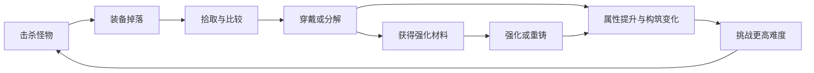
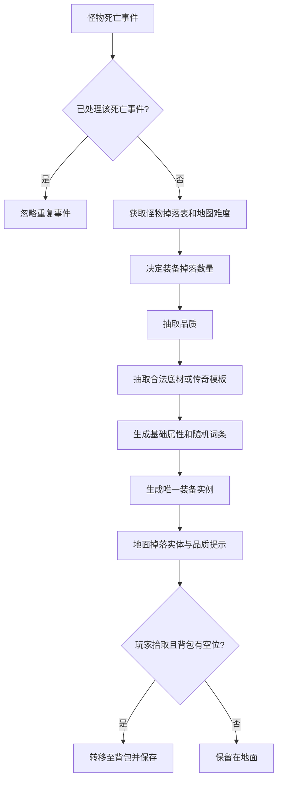
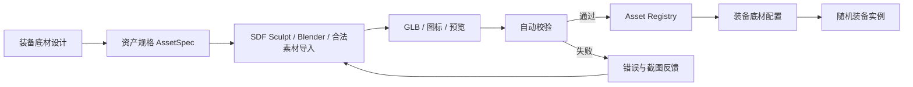

# 装备系统设计规格（Equipment System Specification）

> 项目：3D 刷宝 ARPG 网页游戏（暂用项目代号 Endless Odyssey / 无尽之途）  
> 文档版本：v0.1  
> 使用对象：Codex / AI Coding Agent / 游戏开发者  
> 状态：待实现；本文数值是首轮可调配置，不代表已验证的最终平衡。

## 0. 给 Codex 的执行要求

请先阅读当前仓库的 `AGENTS.md`、目录结构、依赖、已有角色属性、战斗、怪物、UI、存档和资产系统，再依据本设计实施。参考项目为 [majo-no-tabitabi](https://github.com/shoal-rat/majo-no-tabitabi)，但不要假设当前仓库已复用其源码。

- 优先沿用当前项目的技术栈与接口；如果项目尚未建立，默认 Three.js + WebGL 2 + TypeScript，UI 与渲染解耦，存档使用 IndexedDB。
- 先实现装备掉落 → 拾取 → 背包 → 穿戴 → 属性生效 → 再次战斗的最小闭环，再扩展强化和重铸。
- 装备、词条、掉落表和强化规则采用数据驱动，不为每件装备编写独立逻辑。
- 先给出简洁的实施计划和接口差异，随后实际编码、测试、运行游戏、截图验收；不要只输出方案。
- 不要重写已经可用的游戏引擎；不引入多人交易、支付、服务端或新的重型框架作为前置依赖。
- 保留现有功能与存档；如果需要改变持久化结构，提供迁移逻辑。
- 如发现本规格与既有实现冲突，记录冲突、选择和原因，保证核心玩法不被破坏。

---

## 1. 设计目标

装备是游戏中最重要的长期成长与随机奖励来源。玩家能够在击杀怪物后获得不同品质、不同属性和不同特殊机制的装备，通过组合装备、技能和天赋形成不同 Build。

### 1.1 核心循环



### 1.2 设计原则

1. **随机但可理解**：同一种装备底材可以产生大量不同实例；玩家能看懂品质、数值和词条来源。
2. **成长不只是数字**：高阶装备可以改变技能行为，例如暴击触发连锁闪电，而非只有攻击力增加。
3. **装备底材与实例分离**：模型、图标和基础类型可以复用，不要求每次掉落都生成新的美术资源。
4. **可长期扩展**：新增普通装备主要增加 JSON 配置与资产；只有引入全新玩法机制时才增加受控的效果处理器。
5. **可测试**：随机生成支持注入种子；掉落、属性计算、穿戴和强化逻辑不依赖 WebGL，可独立测试。
6. **无付费随机抽取**：首版所有奖励通过游戏玩法获得，不设计现金购买随机装备。

## 2. 首版范围与扩展边界

| 功能 | P0：可玩闭环 | P1：构筑扩展 | P2：后续 |
|---|---|---|---|
| 装备槽位 | 武器、头部、胸甲、手部、脚部、饰品 | 副手、双手武器互斥、双戒指 | 套装与职业专属槽 |
| 装备品质 | 普通、魔法、稀有、史诗、传说 | 更丰富的传奇特效 | 特殊赛季品质（如有必要） |
| 掉落 | 普通怪、精英、Boss | 难度与地图掉落池 | 定向刷取、赛季掉落 |
| 装备管理 | 拾取、背包、比较、穿戴、卸下、分解 | 筛选、排序、锁定 | 仓库、流派预设 |
| 强化 | 预留等级与接口 | +1 至 +10、随机词条重铸 | 更深的打造机制 |
| 传奇特效 | 1 个可验证的触发效果 | 3–5 个可组合效果 | 技能形态、召唤等 |
| 存档 | 本地持久化与版本字段 | 迁移、损坏恢复 | 云端同步（独立设计） |

建议首版内容量：6 类槽位、12 种装备底材、12 种普通词条、1 个传奇特效、3 类怪物掉落表。数量是建议，不应阻碍最小闭环先运行。

## 3. 装备分类与品质

### 3.1 槽位与底材

| 槽位 ID | 示例底材 | 主要属性 |
|---|---|---|
| `weapon` | 铁剑、战斧、法杖 | 基础伤害、攻击频率 |
| `head` | 皮帽、铁盔 | 生命、护甲 |
| `chest` | 皮甲、锁子甲 | 护甲、生命 |
| `hands` | 皮手套、铁手套 | 护甲、攻速词条 |
| `feet` | 旅行靴、铁靴 | 护甲、移速词条 |
| `accessory` | 护符、戒指 | 元素伤害、暴击、回复 |

P0 只设一个饰品槽。双手武器、副手、多个戒指和职业限制延至 P1，避免早期增加无必要的状态组合。

### 3.2 品质规则

| 品质 ID | 中文 | UI 颜色（建议） | 随机普通词条数量 | 特殊词条 |
|---|---|---|---:|---|
| `common` | 普通 | 灰白 `#B8BEC7` | 0 | 无 |
| `magic` | 魔法 | 蓝 `#6196F5` | 1–2 | 无 |
| `rare` | 稀有 | 金黄 `#EAC45E` | 3–4 | 无 |
| `epic` | 史诗 | 紫 `#AE78E8` | 4–5 | 无 |
| `legendary` | 传说 | 橙 `#F0A34B` | 4–5 | 1 个固定传奇效果 |

品质影响随机词条数量、可用掉落池和词条阶级分布，但不保证品质更高就必然适合当前 Build。品质除了颜色还须显示中文名称或符号，便于辨识。

### 3.3 等级定义

- **角色等级（playerLevel）**：角色通过经验成长。
- **装备物品等级（itemLevel / ilvl）**：掉落时确定，决定基础属性与词条可用阶级；不是强化等级。
- **需求等级（requiredLevel）**：穿戴限制。初始默认 `max(base.minRequiredLevel, floor(itemLevel * 0.8), 1)`，由配置控制。
- **强化等级（upgradeLevel）**：P0 固定为 0，P1 默认 0–10；不改变需求等级或物品等级。

物品等级由掉落来源决定，默认普通怪为怪物等级、精英 +1、Boss +2，最低为 1；配置可限制地图等级区间。角色低于需求等级时可以拾取，但不能穿戴。

## 4. 属性与随机词条

### 4.1 基础属性 ID

| 属性 | ID | 单位 / 语义 |
|---|---|---|
| 武器最小伤害 | `weaponDamageMin` | 数值 |
| 武器最大伤害 | `weaponDamageMax` | 数值 |
| 基础攻击速度 | `baseAttackSpeed` | 次/秒，仅武器基础值 |
| 攻击力 | `attackPower` | 数值 |
| 最大生命 | `maxHealth` | 数值 |
| 护甲 | `armor` | 数值 |
| 暴击率 | `critChance` | 比例，0.10 = 10 个百分点 |
| 暴击伤害倍率 | `critMultiplier` | 倍率，1.5 = 150% |
| 攻速加成 | `attackSpeedBonus` | 比例，0.20 = +20% |
| 移速加成 | `moveSpeedBonus` | 比例 |
| 火/冰/雷附加伤害 | `fireDamage` / `iceDamage` / `lightningDamage` | 数值 |
| 生命回复 | `healthRegen` | 每秒生命数值 |
| 生命偷取 | `lifeSteal` | 直接命中实际伤害的比例，P1 |

属性 ID 如与现有战斗系统不同，实施时建立明确映射，避免两套属性定义并存。P0 未实现的属性不要生成到可掉落装备中，防止出现无效词条。

### 4.2 随机词条配置示例

词条分前缀与后缀，并用 `exclusiveGroup` 控制互斥。以下表为 T1 初始数值示例，需根据战斗节奏调优。

| ID | 名称 | 属性 | 类型 | T1 范围 | 适用部位 |
|---|---|---|---|---|---|
| `affix_attack_flat` | 锋利的 | 攻击力 | 前缀 | +3–8 | 武器、饰品 |
| `affix_attack_pct` | 毁灭的 | 攻击力百分比 | 前缀 | +5%–10% | 武器 |
| `affix_health` | 坚韧的 | 最大生命 | 前缀 | +10–25 | 防具、饰品 |
| `affix_armor` | 坚固的 | 护甲 | 前缀 | +4–12 | 防具 |
| `affix_lightning` | 雷鸣的 | 附加雷伤 | 前缀 | +2–6 | 武器、饰品 |
| `affix_fire` | 灼热的 | 附加火伤 | 前缀 | +2–6 | 武器、饰品 |
| `affix_ice` | 霜寒的 | 附加冰伤 | 前缀 | +2–6 | 武器、饰品 |
| `affix_crit` | 精准 | 暴击率 | 后缀 | +2–5 个百分点 | 武器、饰品 |
| `affix_crit_multi` | 致命 | 暴伤倍率 | 后缀 | +0.10–0.20 | 武器、饰品 |
| `affix_attack_speed` | 迅捷 | 攻速加成 | 后缀 | +5%–10% | 武器、手部、饰品 |
| `affix_move_speed` | 疾行 | 移速加成 | 后缀 | +3%–8% | 脚部 |
| `affix_regen` | 再生 | 每秒回复 | 后缀 | +1–3 | 防具、饰品 |

建议 P0 为各槽位补充足够的合法词条，以免高品质装备达不到所需数量。禁止靠重复同一互斥组凑数；若合法池不足，应停止生成并返回明确配置错误，在构建检查中发现该问题。

### 4.3 词条阶级（Tier）

本文采用 **T1 最低、T5 最高** 的约定，与部分现有 ARPG 不同，UI 和代码必须保持一致。

| 阶级 | 最低物品等级 | 数值倍率（相对 T1） |
|---|---:|---:|
| T1 | 1 | 1.0 |
| T2 | 10 | 1.5 |
| T3 | 20 | 2.2 |
| T4 | 35 | 3.1 |
| T5 | 50 | 4.5 |

倍率只是生成数值范围的初始参考；暴击率、攻速、移速等属性应允许单独配置各阶范围，不要机械乘倍数导致失衡。每个阶级配置独立权重，生成时先过滤物品等级和品质允许的阶级，再按权重抽取。

### 4.4 词条生成算法

1. 根据品质确定前缀与后缀预算：魔法各最多 1；稀有各最多 2；史诗与传说各最多 3，总数不得超过 5。
2. 过滤不适合当前槽位、标签、物品等级或品质的词条。
3. 按配置权重抽取词条定义，排除已选择的 ID 与互斥组。
4. 抽取合法 Tier，再在该 Tier 的 min/max 区间内抽取数值，按属性精度量化。
5. 保存实际结果和 Tier，不能每次打开背包重新抽取。
6. 传说装备额外读取传奇模板的固定效果 ID。

建议每个实例保存其生成时的数值快照，以免修改配置后旧装备无意中变化；配置变更如何影响旧装备应作为显式版本策略处理。

## 5. 数据模型与配置契约

以下 TypeScript 为建议接口，Codex 应与现有项目类型合并，不要求逐字复制。JSON 配置需通过 Zod 或现有 schema 校验工具校验，避免仅依赖 TypeScript 静态类型检查。

```ts
export type EquipmentSlot = 'weapon' | 'head' | 'chest' | 'hands' | 'feet' | 'accessory';
export type Rarity = 'common' | 'magic' | 'rare' | 'epic' | 'legendary';
export type StatId =
  | 'weaponDamageMin' | 'weaponDamageMax' | 'baseAttackSpeed'
  | 'attackPower' | 'maxHealth' | 'armor' | 'critChance'
  | 'critMultiplier' | 'attackSpeedBonus' | 'moveSpeedBonus'
  | 'fireDamage' | 'iceDamage' | 'lightningDamage' | 'healthRegen' | 'lifeSteal';
export type ModifierOperation = 'flat' | 'increased' | 'more';
export interface StatModifier {
  stat: StatId;
  operation: ModifierOperation;
  value: number;
}
export interface EquipmentBase {
  id: string;
  name: string;
  slot: EquipmentSlot;
  tags: string[];
  minRequiredLevel: number;
  baseStats: StatModifier[];
  assetId: string;
  dropWeight: number;
}
export interface AffixTier {
  tier: number;
  minItemLevel: number;
  min: number;
  max: number;
  weight: number;
}
export interface AffixDefinition {
  id: string;
  name: string;
  kind: 'prefix' | 'suffix';
  stat: StatId;
  operation: ModifierOperation;
  allowedSlots: EquipmentSlot[];
  exclusiveGroup: string;
  weight: number;
  tiers: AffixTier[];
}
export interface RolledAffix {
  affixId: string;
  tier: number;
  modifier: StatModifier;
}
export interface LegendaryEffectRef {
  effectId: string;
  params: Record<string, number>;
}
export interface EquipmentInstance {
  instanceId: string;
  schemaVersion: number;
  configVersion: string;
  baseId: string;
  legendaryTemplateId?: string;
  rarity: Rarity;
  itemLevel: number;
  requiredLevel: number;
  upgradeLevel: number;
  baseStats: StatModifier[];
  affixes: RolledAffix[];
  legendaryEffect?: LegendaryEffectRef;
  createdAt: number;
  locked: boolean;
}
export interface InventoryState {
  capacity: number;
  items: EquipmentInstance[]; // 仅包含背包中未穿戴装备
  equipped: Partial<Record<EquipmentSlot, EquipmentInstance>>;
  materials: Record<string, number>;
  gold: number;
}
```

约束：`instanceId` 在同一个存档中唯一；一个实例任一时刻只能位于地面、背包或一个装备槽中。`locked` 主要防止分解、出售等破坏性操作，不禁止穿戴。生成时注入 RNG，实例 ID 和时间来源也应可注入，便于测试；生产运行不得使用固定种子重复生成同一实例。

### 5.1 示例装备：雷霆之誓

以下是用于 UI 和效果测试的示例实例，数值仅为演示，不代表真实掉落结果。该例的词条需在配置中提供对应阶级与范围。

```json
{
  "instanceId": "fixture-thunder-oath-001",
  "schemaVersion": 1,
  "configVersion": "0.1.0",
  "baseId": "base_iron_sword",
  "legendaryTemplateId": "legendary_thunder_oath",
  "rarity": "legendary",
  "itemLevel": 32,
  "requiredLevel": 25,
  "upgradeLevel": 0,
  "baseStats": [
    { "stat": "weaponDamageMin", "operation": "flat", "value": 128 },
    { "stat": "weaponDamageMax", "operation": "flat", "value": 186 },
    { "stat": "baseAttackSpeed", "operation": "flat", "value": 1.6 }
  ],
  "affixes": [
    { "affixId": "affix_attack_speed", "tier": 3, "modifier": { "stat": "attackSpeedBonus", "operation": "flat", "value": 0.24 } },
    { "affixId": "affix_crit", "tier": 3, "modifier": { "stat": "critChance", "operation": "flat", "value": 0.18 } },
    { "affixId": "affix_lightning", "tier": 3, "modifier": { "stat": "lightningDamage", "operation": "flat", "value": 36 } },
    { "affixId": "affix_attack_flat", "tier": 3, "modifier": { "stat": "attackPower", "operation": "flat", "value": 16 } }
  ],
  "legendaryEffect": {
    "effectId": "chain_lightning_on_crit",
    "params": { "maxTargets": 5, "damageRatio": 0.35, "cooldownSeconds": 1.5, "jumpRadius": 5 }
  },
  "createdAt": 0,
  "locked": false
}
```

该实例专门展示高等级词条和效果。若按 §4 的默认 T1 倍率无法生成这些数值，实际配置应调整为合法范围，或将该实例仅作为独立 UI fixture，不得绕过生产校验。

## 6. 掉落系统（Loot System）

### 6.1 掉落流程



### 6.2 初始掉落概率（可调）

以下采用两阶段抽取：先决定是否掉装备，再在已确定掉落的装备中决定品质，不能把两种概率混淆。

| 怪物类型 | 装备掉落概率 | 单次掉落件数 | 普通 | 魔法 | 稀有 | 史诗 | 传说 |
|---|---:|---:|---:|---:|---:|---:|---:|
| 普通怪 | 20% | 1 | 65% | 25% | 9% | 0.9% | 0.1% |
| 精英怪 | 75% | 1 | 30% | 40% | 25% | 4% | 1% |
| Boss | 100% | 2–4 | 5% | 20% | 55% | 17% | 3% |

每件掉落独立抽取品质；Boss 的传奇概率不是每次击杀固定 3%。每行品质权重之和为 100%；不同物品等级可配置不同掉落池。对于不可用的品质或传奇模板，必须按预先声明的规则重新归一化合法权重，并验证最终掉率，禁止静默生成不存在的模板。

### 6.3 难度与成长

难度等级影响怪物等级、掉落物品等级和品质权重。P1 可通过 `lootQualityMultiplier` 提升高品质权重并归一化，不直接将所有概率乘同一个常数。避免难度越高、装备无限指数膨胀导致 JavaScript 数值溢出；长期成长可通过新机制、词条组合和受控的等级分段实现。

### 6.4 掉落呈现与拾取

- 掉落物应在怪物死亡位置附近生成，避免落到不可达区域；P0 可使用简化碰撞或地形高度查询。
- 显示装备名称、品质颜色、品质光柱（稀有及以上），高品质可播放独立音效。
- 靠近后按交互键或点击拾取；背包满时提示，不删除物品。
- 普通金币和材料可以自动拾取（可配置），装备默认手动拾取。
- 掉落事件按 `deathEventId` 幂等处理；拾取时只允许一次状态转移，防止重复点击复制装备。
- P0 地面掉落不承诺跨场景或跨重启保留，应明确 UI 规则；已成功拾取的装备必须可恢复。若后续支持地图续玩，再持久化地面掉落与死亡处理状态。

## 7. 穿戴、背包与装备比较

### 7.1 背包操作

建议首版采用 40 格等容量背包，每件装备占一格。不使用复杂的俄罗斯方块式空间管理。

操作：拾取、查看详情、穿戴、卸下、交换、分解；P1 增加搜索、槽位筛选、品质筛选、锁定和排序。

穿戴必须同时验证：实例存在于背包、槽位匹配、角色满足等级要求。若目标槽已有装备，新装备离开背包后腾出的格子应允许旧装备进入，即便操作前背包已满也能完成合法交换。卸下装备时背包满则拒绝操作。所有变更在单次领域事务内完成，失败时状态不变。

分解与出售不能操作已穿戴或锁定装备。史诗及传说装备分解时要求二次确认（P0 至少保证高品质保护）。

### 7.2 装备详情面板

```text
┌──────────────────────────────┐
│  [图标]  雷霆之誓              │
│          传说 · 单手剑         │
│          需求等级 25 · ilvl 32 │
├──────────────────────────────┤
│          128–186 攻击伤害      │
│          1.60 次/秒            │
│          251.2 基础 DPS        │
├──────────────────────────────┤
│  +24% 攻击速度          T3    │
│  +18% 暴击率            T3    │
│  +36 雷元素伤害          T3    │
│  +16 攻击力             T3    │
├──────────────────────────────┤
│  传奇：暴击时释放连锁闪电，    │
│  最多命中5个其他敌人。         │
│  每次跳跃造成35%触发伤害，     │
│  冷却1.5秒。                  │
├──────────────────────────────┤
│     [穿戴] [比较] [分解]       │
└──────────────────────────────┘
```

基础 DPS = `(128 + 186) / 2 × 1.6 = 251.2`，只描述武器基础伤害与攻击频率，不包括词条、天赋、暴击、技能、传奇效果或怪物防御。面板可另外展示实际角色预测 DPS，并明确计算范围。

装备比较使用同一属性计算器对比当前穿戴状态与模拟替换状态，显示攻击力、最大生命、护甲、暴击、攻速等实际变化。传奇机制单独列出，不应硬换算成虚假的精确战力。比较操作不得修改角色状态。

### 7.3 HUD 与反馈

穿戴后及时更新角色属性面板、战斗数值、生命上限与适用模型。最大生命改变时保持当前绝对生命值并限制在新上限内；禁止反复穿卸装备恢复生命，死亡状态也不因换装解除。武器模型资源缺失时使用占位模型，装备属性仍按数据正常生效。

## 8. 属性计算与战斗集成

### 8.1 统一属性解析器

装备、天赋、技能常驻效果等都输出 `StatModifier`，由同一个纯函数计算最终属性。

```text
finalStat = (baseStat + sum(flat))
            × (1 + sum(increased))
            × product(1 + eachMore)
```

- `flat`：直接增加该属性单位，例如暴击率 +0.05 是增加 5 个百分点。
- `increased`：同类百分比相加后乘算，例如攻击力 +10% 与 +20% 合并为 +30%。
- `more`：独立乘区，P0 预留但尽量少用；需要保证每个效果唯一来源并避免重复注册。
- `baseAttackSpeed`、武器伤害由装备武器底材提供；空手时使用角色默认武器配置，不与穿戴武器基础值叠加。
- `attackSpeedBonus` 等专用加成属性以 `flat` 存储比例，最终攻击频率 = 基础攻击频率 × (1 + 攻速加成)。不要把同一攻速加成在两处乘算。
- 对暴击率、移速、攻速、减伤等配置合理上下限；P0 示例：暴击率 0–0.75，最终攻击频率 0.2–8 次/秒。所有概率在运行时限制为 [0,1]。
- 属性变化时重算，普通帧不重复遍历全量装备；事件触发后同步更新缓存。

### 8.2 示例战斗公式

若已有战斗公式，优先沿用并集成新属性；下面仅为尚无实现时的简化参考。

```text
weaponRoll = uniform(weaponDamageMin, weaponDamageMax)
physical = (weaponRoll + attackPower) × skillDamageMultiplier
physicalAfterArmor = physical × K / (K + max(0, targetArmor))
elemental = fireDamage + iceDamage + lightningDamage
hit = max(0, physicalAfterArmor + elemental)
finalHit = isCrit ? hit × critMultiplier : hit
```

`K` 为可调常数，首版示例 100。首版不实现元素抗性时明确说明元素伤害暂不受护甲影响；后续引入元素抗性需独立测试。攻击间隔、技能冷却和伤害结算必须由实际属性驱动，不能只改变 UI。

内部使用有限数值，展示时才舍入。计算出的 NaN、Infinity、非法负值应被拒绝或显式处理；不能污染角色存档。

## 9. 传奇装备机制

传奇装备需要改变战斗行为，而不是单纯增加数值。采用效果注册表，通过 `effectId` 和参数引用已实现的处理器，禁止在 JSON 中存放可执行脚本或通过 `eval` 动态运行代码。

| 效果 ID | 装备示例 | 机制 | 阶段 |
|---|---|---|---|
| `chain_lightning_on_crit` | 雷霆之誓 | 暴击触发连锁闪电 | P0 |
| `heal_on_kill` | 饮血之刃 | 击杀恢复一定生命 | P1 |
| `burn_on_hit` | 灰烬法杖 | 命中施加持续燃烧 | P1 |
| `shield_on_low_health` | 不屈之心 | 低血量触发护盾，带冷却 | P1 |
| `extra_projectile` | 星陨之弓 | 技能发射额外投射物 | P2 |

### 9.1 雷霆之誓行为契约

- 触发事件：玩家直接攻击造成一次有效暴击。
- 从原始目标附近 5 个世界单位内寻找最近的未命中存活敌人，最多额外命中 5 个不同目标；每次跳跃以最新目标为中心重新搜索。
- 每次跳跃伤害为触发攻击实际结算伤害的 35%，标记为传奇额外雷伤；P0 不重复应用同一攻击的暴击倍率或元素抗性（后续抗性模型应明确定义）。
- 单个效果实例冷却 1.5 秒，采用游戏时钟；装备换下再换回不能绕过冷却，角色存档重载也不得用于反复刷新效果（P0 如未保存冷却，应在加载时施加完整冷却）。
- 连锁闪电本身不触发暴击、不再触发同类 `onCrit` / `onHit` 传奇效果，防止无限递归。其击杀仍正常发放一次经验和掉落。
- 特效播放与伤害结算解耦；缺失 VFX 不影响游戏逻辑，需记录错误并使用占位特效。

## 10. 装备强化、重铸与材料经济（P1）

### 10.1 强化

采用确定性强化，不破坏装备、不掉级。首版最大强化 +10，以后可通过新的成长系统扩展，不直接把数值推向无限大。

- 每一级让可强化基础属性相对原始基础数值提高 5%，`upgradeMultiplier = 1 + upgradeLevel × 0.05`。
- 可强化范围：武器基础最小/最大伤害、防具基础护甲和生命、饰品明确标记的基础数值；不强化攻击频率、随机词条或传奇参数。
- 保留原始 baseStats，计算时应用强化倍率；不要反复修改原始值导致累计误差。
- 从当前等级 `n` 升至 `n+1` 的示例成本：金币 `50 × (n+1)^2`，强化碎片 `2 × (n+1)`。例如 +0→+1 消耗 50 金币和 2 碎片。
- 校验余额、材料、实例位置、等级上限后原子扣除并更新；失败不扣资源。强化已穿戴装备后立即重算属性。

### 10.2 词条重铸

P1 先实现一种机制：重铸指定现有普通词条的数值，不改变词条 ID、阶级、底材、品质、强化等级或传奇效果。

玩家预先查看成本、数值区间及可能变差的提示，确认后扣除金币与重铸材料，重新抽取数值并保存。允许生成原值，不保证更好。洗词条类型、锁定多词条等更复杂功能留到 P2。

### 10.3 分解产出

| 品质 | 强化碎片 | 重铸晶石 |
|---|---:|---:|
| 普通 | 1 | 0 |
| 魔法 | 2 | 0 |
| 稀有 | 4 | 1 |
| 史诗 | 8 | 2 |
| 传说 | 15 | 5 |

初始设定中，分解不退还强化消耗，界面须明确提示。金币来源为怪物及未来任务；材料来源为分解和可配置的怪物掉落。平衡目标是让无用装备也有价值，但不出现无限循环复制资源或可逆套利。

## 11. 与 AI 游戏资产生产流水线集成

装备实例不需要独立 GLB。**装备底材引用可复用美术资产，随机实例只保存数值和效果。** 例如同一把铁剑模型可支持数百种随机词条组合，品质变化可通过颜色、粒子或受控材质变体表示。



### 11.1 Asset Registry 参考格式

```json
{
  "assetId": "weapon_iron_sword_v1",
  "category": "weapon",
  "model": "assets/models/weapons/iron_sword.glb",
  "icon": "assets/icons/weapons/iron_sword.webp",
  "preview": "assets/previews/weapons/iron_sword.webp",
  "version": 1,
  "attachmentSocket": "hand_r",
  "source": { "type": "original", "license": "project-owned" },
  "status": "approved"
}
```

以上为路径和字段示例，不代表文件已存在。第三方资产必须记录实际作者、来源 URL、许可与署名要求；未明确许可或未验收的资产不能进入发布包。AI 生成资产也应记录生产工具与输入来源（如适用）。

### 11.2 资产验收标准

- GLB 可被 Three.js GLTFLoader 成功加载；坐标、尺寸、模型原点、握持点与角色骨骼约定一致。
- GLB 与纹理文件存在；没有未解析的外部资源路径。模型不能包含 NaN 几何数据或明显缺失材质。
- P0 武器目标预算（可调）：5,000 三角面以内，纹理最长边 1024px，单模型文件目标不超过 1 MB；超预算进入人工/AI 审查，不可静默忽略。
- 自动生成正面、侧面、斜视角预览和背包图标；检查握持点及角色手持效果。视觉风格最终需要截图审查，不能仅凭 GLB 格式验证宣布美术合格。
- P0 可以仅使用占位模型或少量合法素材，先验证完整管线；防具可暂时不换外观，UI 不应暗示已实现全身换装。

## 12. 工程结构建议

```text
src/
  equipment/
    types.ts
    catalog.ts
    item-generator.ts
    affix-roller.ts
    equipment-service.ts
    upgrade-service.ts        # P1
    effect-registry.ts
  loot/
    drop-table.ts
    loot-service.ts
    ground-loot.ts
  inventory/
    inventory-service.ts
  stats/
    stat-resolver.ts
  ui/
    inventory/
    equipment-tooltip/
    loot-label/
  save/
    migrations/
data/
  equipment/
    bases.json
    rarities.json
    affixes.json
    legendary.json
    upgrade-rules.json
  loot/
    normal.json
    elite.json
    boss.json
  assets/registry.json
assets/
  models/weapons/
  icons/weapons/
  previews/weapons/
  vfx/
tools/
  asset-pipeline/
  asset-validator/
  balance/
tests/
  unit/
  integration/
  e2e/
```

根据现有目录调整；不必为了匹配目录而搬迁正常工作的代码。

### 12.1 模块边界

| 模块 | 职责 | 不负责 |
|---|---|---|
| Equipment Catalog | 加载、校验静态配置 | 角色属性变化 |
| Item Generator | 由掉落上下文生成装备实例 | UI、背包操作 |
| Loot Service | 死亡事件 → 掉落实例 | 穿戴、强化 |
| Inventory / Equipment Service | 物品所有权、合法状态转移 | 渲染、词条随机抽取 |
| Stat Resolver | 纯函数解析属性 | 写入背包、生成掉落 |
| Effect Registry | 注册与执行已知传奇机制 | 任意脚本执行 |
| UI | 展示状态、提交用户意图 | 直接修改领域状态 |
| Asset Registry | 模型、图标与版本索引 | 装备数值与掉落概率 |

可使用现有事件总线或简单领域事件接口，避免一开始为单机游戏引入复杂分布式架构。关键事件可包括 `enemyDied`、`lootSpawned`、`itemPickedUp`、`equipmentChanged`、`statsChanged`、`itemUpgraded`。

## 13. 存档、一致性与配置校验

- 持久化完整装备实例、背包、装备槽、金币、材料、角色等级和存档版本。不要只存 baseId，否则随机装备会丢失其唯一属性。
- 每次关键操作成功后提交一致的快照；使用 IndexedDB 事务或现有原子存档机制。存档失败应明确提示，允许重试，不能声称已保存。
- 读取存档时检查 schemaVersion，执行已知版本迁移；无可用迁移或文件损坏时保留原始数据并进入恢复流程，不静默覆盖。
- 同一 `instanceId` 不得同时出现在背包和装备槽。恢复时检测冲突，避免复制装备或删除有效数据；记录可诊断错误。
- 配置启动检查：ID 唯一、引用有效、权重非负且合法池非空、词条 min≤max、阶级范围有效、模型与图标路径有效、传奇处理器已注册。
- 验证各可掉落底材在各相关等级和品质下是否有足够的合法词条组合（含前后缀、互斥约束）；开发时尽早报错。
- 浏览器本地存档可被玩家修改，P0 不宣称防作弊；如果未来多人联机，物品生成与所有权必须迁移到权威服务端。

## 14. 测试与验收

### 14.1 单元测试

- 相同 RNG 种子、同一配置和相同输入下，生成的随机属性一致；固定时钟/ID 后完整实例也可复现。
- 每种品质的词条数量符合规则，词条不重复、互斥组不冲突、阶级不超过等级限制。
- 不合法的槽位、等级、重复拾取、重复死亡事件、背包满等边界得到正确结果。
- 满背包合法换装成功，满背包卸下失败；锁定装备不能分解。
- 属性解析与 UI 对比计算一致；反复穿卸同一装备不会累计属性或回复生命。
- 传奇连锁闪电遵循目标上限、距离、冷却、去重和禁止递归规则。
- 强化、重铸、分解在 P1 测试资源不足、最大等级、原子扣除及配置错误。
- 存档 round-trip 后，装备 ID、品质、数值、词条和强化等级保持一致。

### 14.2 掉率模拟

编写 `tools/balance/simulate-loot`，支持固定种子、怪物类型、物品等级、难度和模拟次数，输出掉落件数、品质分布、词条分布及异常配置。

建议每类至少模拟 100,000 次击杀，并将观察频率与理论概率及抽样误差比较（稀有事件可增加样本量）；不得要求随机结果逐项恰好等于配置概率。可使用固定种子的大样本回归与精确权重单元测试相结合，防止测试偶发失败。

### 14.3 浏览器端到端验收（P0）

| ID | 操作 | 验收结果 |
|---|---|---|
| E01 | 击杀普通怪/精英/Boss | 按配置掉落；Boss 至少掉 2 件装备 |
| E02 | 靠近并拾取装备 | 地面物品消失，背包新增同一实例 |
| E03 | 查看装备详情 | 品质、等级、基础数值、词条与真实实例一致 |
| E04 | 穿戴新武器后攻击 | 角色面板及实际伤害同步变化 |
| E05 | 比较两件装备 | 正确显示属性差异，不改变实际穿戴 |
| E06 | 尝试拾取满背包外装备 | 有提示，装备仍在地面 |
| E07 | 低等级穿戴高等级装备 | 失败且物品不丢失 |
| E08 | 分解允许的装备 | 装备减少、材料增加，操作不可重复 |
| E09 | 触发雷霆之誓 | 连锁效果和实际伤害满足契约 |
| E10 | 刷新网页或重启游戏 | 已保存装备、属性和材料恢复 |
| E11 | 资产缺失模拟 | 有占位表现和日志，战斗与背包仍可用 |

随机掉落测试使用专用 fixture / 固定种子 / 测试掉落表，不把保底测试逻辑混进正常游戏配置。使用实际浏览器截图验证背包、详情、地面光柱、穿戴前后和传奇触发效果；保留截图或测试报告。不能只根据代码推断视觉效果。

## 15. 实施顺序与交付要求

### 阶段 A：数据与属性内核

实现类型、静态配置、校验器、确定性随机生成器、统一属性解析器及单元测试。产出至少 3 个可生成底材和若干真实生效词条。

### 阶段 B：可玩刷宝闭环

接入怪物死亡事件、地面掉落、拾取、背包、穿戴、卸下、比较、分解和存档。至少实现普通怪、精英、Boss 的差异掉落。完成穿戴前后真实战斗对比。

### 阶段 C：传奇机制与美术集成

实现雷霆之誓，接入资产注册表、可复用武器模型、图标及品质反馈。完成一个从资产规格到 GLB 验收再到装备底材引用的最小资产生产闭环。逐步扩充到首版建议内容量。

### 阶段 D：强化与长期成长（P1）

接入强化、数值重铸、经济材料、难度掉落权重及更多传奇效果；通过模拟和实际游玩调平。与天赋系统共用属性接口，而不是再建一套属性系统。

### Codex 每阶段必须提交

- 实际修改的文件及模块边界说明。
- 配置示例与必要的运行命令（沿用仓库实际命令，不假定脚本存在）。
- 单元、集成、浏览器验收结果，明确区分已运行通过、失败和未执行项。
- 可复现的截图/录屏路径（如当前运行环境支持）。
- 剩余问题、兼容风险、未实现功能及下一阶段建议。

**P0 Definition of Done：** 玩家可以进入地图，打怪获得不同品质的随机装备，拾取并查看词条，穿戴后真实战斗能力改变，分解无用装备，触发至少一种传奇特效，刷新页面后保留已获得的装备。核心逻辑有自动化测试，且通过实际浏览器验收。完成这些之前，不优先扩展多人联机、大型地图或数百种装备。

---

## 16. 后续需通过实玩确定的数值

本文的掉率、词条范围、强化成本、攻击公式、槽位和内容数量是设计起点，而不是最终答案。重点验证：普通怪平均多久掉一件装备、精英/Boss 是否有足够奖励、装备替换频率、升级速度、不同 Build 的收益，以及数值成长能否长期保持可控。

先建立可验证、可扩展的刷宝闭环，再持续迭代内容与平衡。
